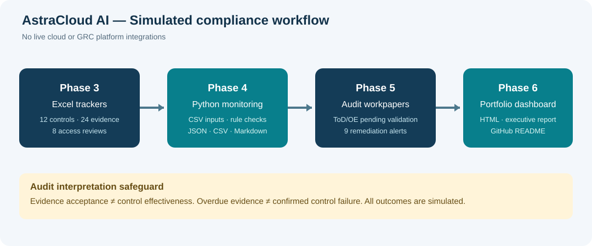

# AstraCloud AI — SOC 2 Continuous Compliance & Audit Readiness Lab

> **SIMULATED PORTFOLIO PROJECT.** AstraCloud AI is fictional. No actual SOC 2 examination or certification took place. This project is not affiliated with Vanta or Drata and does not connect to either platform or to live AWS, GitHub, or identity systems.

## Overview

A practical governance, risk and compliance (GRC) lab demonstrating a **Vanta/Drata-inspired** evidence collection, access review, compliance monitoring, and preliminary audit-testing workflow. This portfolio builds on an existing Enterprise GRC project by focusing on **continuous control monitoring and audit readiness**, rather than repeating vendor-risk program design.



## Results from the supplied project files

**Snapshot: July 31, 2026; historical review period: January 1–June 30, 2026.**

| Metric | Simulated result |
|---|---:|
| Controls in scope | 12 |
| Evidence requests | 24 |
| Evidence accepted | 17 |
| Evidence acceptance rate | 70.8% |
| Overdue evidence requests | 6 |
| Evidence exceptions | 1 |
| Access review records | 8 |
| Outstanding access-review alerts | 2 |
| Total alert records | 9 |

**Interpretation:** The acceptance rate measures tracking records, **not SOC 2 compliance**. Alerts are not independently confirmed control failures. ToD and OE conclusions remain pending inspection of underlying evidence.

## Open the executive dashboard

Open [`dashboard/index.html`](dashboard/index.html) in a browser. It is a **static, offline HTML snapshot** built from the Phase 4 `compliance_results.json` output. It does not automatically refresh after edits; rerun the monitor and regenerate the dashboard for updated values.

## Repository layout

```text
phase3/                  Original Excel compliance dashboard
  AstraCloud_SOC2_Phase3_Compliance_Dashboard.xlsx
automation/              Original Phase 4 monitoring script and CSV exports
  compliance_monitor.py
  data/{controls,evidence,access_reviews}.csv
  output/{compliance_results.json,compliance_alerts.csv,management_report.md}
audit/                   Original Phase 5 workpapers and findings
  control_testing.csv
  findings_and_remediation.csv
  phase5_executive_audit_report.md
  audit_workpaper_instructions.md
  source_manifest.json
dashboard/index.html     Offline executive dashboard (frozen snapshot)
assets/architecture.svg  Data flow diagram
docs/executive_report.md Final executive report
docs/resume_bullets.md   Resume and interview language
source_integrity.json    SHA-256 hashes for copied original artifacts
```

## Reproduce Phase 4 monitoring

Requires Python 3.9+; no third-party packages.

```bash
cd automation
python compliance_monitor.py --as-of 2026-07-31
```

Outputs are written to `automation/output/`. Input data uses fictional records and may contain Excel date serial numbers. See [`automation/README.md`](automation/README.md) for instructions and sample exercises.

## Audit workflow

1. Define 12 controls, owners, review frequency, and required evidence in the Phase 3 workbook.
2. Export control, evidence, and access review data to CSV.
3. Evaluate the CSV exports with Python and produce evidence/access-review alerts.
4. Use Phase 5 workpapers to plan ToD/OE procedures and document unresolved issues.
5. Review the dashboard and executive report; validate source evidence **before** drawing conclusions.

## Key learning objectives

- SOC 2 Security Trust Services Criteria and illustrative NIST CSF 2.0 / ISO/IEC 27001:2022 mappings
- Evidence tracking, review status, and audit readiness
- Access review exception management and corrective action follow-up
- Python automation and Git-friendly Markdown/CSV/JSON workflows
- Management reporting and clear separation of **monitoring signals** from **assurance conclusions**

## Limitations and ethical disclosure

This repository contains synthetic data only. All source evidence locations are placeholders. Neither an external auditor nor a live GRC platform validated the controls. The exercise demonstrates **simulation and portfolio skills**, not professional audit engagement, SOC 2 certification, or actual Vanta/Drata product experience.
